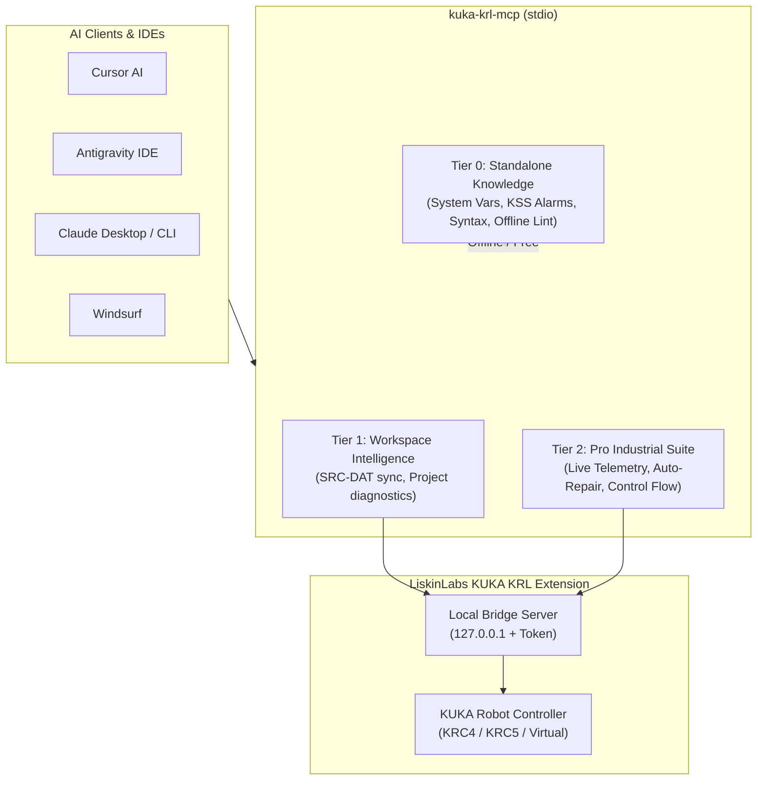

# KUKA KRL MCP Server

[](LICENSE)
[](https://modelcontextprotocol.io)
[](https://marketplace.visualstudio.com/items?itemName=LiskinLabs.kuka-krl-extension)

Official open-source [Model Context Protocol (MCP)](https://modelcontextprotocol.io) server for **KUKA Robot Language (KRL)** and **KUKA System Software (KSS 8.3–8.7)**.

Empowers AI coding assistants (**Cursor, Google Antigravity, Claude Desktop, Claude Code CLI, Windsurf, Copilot**) with industrial robotics knowledge, motion safety analysis, KSS error diagnosis, workspace continuous verification, and live controller telemetry.

---

## Architecture: Hybrid Three-Tier Pipeline



1. **Tier 0: Standalone Knowledge (Free & Offline):**
   - Instant access to KSS system variables (`$TOOL`, `$BASE`, `$OV_PRO`, `$VEL`, `$ACC`, `$IN`, `$OUT`, `$TIMER`).
   - KSS alarm catalog (codes 1, 14, 20, 67, 71, 1376, 1422, 2858) with root cause analysis and SmartPAD reset steps in 6 languages.
   - KRL motion syntax reference (PTP, LIN, CIRC, SPLINE, INTERRUPT, TRIGGER, FOLD).
   - Fast static linter for code snippets.
2. **Tier 1: Workspace Intelligence (Requires [KUKA KRL Extension](https://marketplace.visualstudio.com/items?itemName=LiskinLabs.kuka-krl-extension)):**
   - Project-wide continuous diagnostics, SRC↔DAT pair integrity, CIRC 2-point geometry, physical I/O ranges.
3. **Tier 2: Professional Industrial Suite (Requires [KUKA KRL Pro](https://marketplace.visualstudio.com/items?itemName=LiskinLabs.kuka-krl-extension)):**
   - Deep industrial safety audit (advance run hazards, turn unwinding, payload limits).
   - Safe auto-repair with verified code diffs.
   - Real-time controller telemetry reading (actual TCP position, joint angles, active program line pointer, SmartPAD alarms).

---

## Quickstart & Client Configuration

### 1. Cursor
Add to your project's `.cursor/mcp.json` or Cursor Settings > MCP:

```json
{
  "mcpServers": {
    "kuka-krl": {
      "command": "npx",
      "args": ["-y", "kuka-krl-mcp"]
    }
  }
}
```

*Note:* If you have the [LiskinLabs KUKA KRL Extension](https://marketplace.visualstudio.com/items?itemName=LiskinLabs.kuka-krl-extension) installed in Cursor, the extension **automatically registers** the MCP server with the local bridge credentials at startup!

### 2. Google Antigravity IDE
In Antigravity settings or `~/.gemini/antigravity/mcp_config.json`:

```json
{
  "mcpServers": {
    "kuka-krl": {
      "command": "npx",
      "args": ["-y", "kuka-krl-mcp"]
    }
  }
}
```

### 3. Claude Desktop
Add to `%APPDATA%\Claude\claude_desktop_config.json` (Windows) or `~/Library/Application Support/Claude/claude_desktop_config.json` (macOS):

```json
{
  "mcpServers": {
    "kuka-krl": {
      "command": "npx",
      "args": ["-y", "kuka-krl-mcp"]
    }
  }
}
```

### 4. Claude Code CLI
```bash
claude mcp add kuka-krl npx -y kuka-krl-mcp
```

---

## Available MCP Tools

| Tool | Tier | Description |
| :--- | :---: | :--- |
| `krl_lookup_system_var` | **0** | Looks up KSS system variables (`$TOOL`, `$BASE`, `$OV_PRO`, `$VEL.CP`, etc.) with types, syntax, and examples in 6 languages (EN, RU, DE, ES, IT, TR). |
| `krl_lookup_kss_message` | **0** | Decodes KSS error numbers (e.g. 1376, 67, 2858) into root causes and SmartPAD step-by-step remediation procedures. |
| `krl_syntax_reference` | **0** | Provides language reference and code examples for PTP, LIN, CIRC, SPLINE, INTERRUPT, TRIGGER, FOLD, WAIT, CONTINUE. |
| `krl_lint_snippet` | **0** | Fast offline static linter: detects uninitialized $TOOL/$BASE, infinite loops, div-by-zero, unbalanced folds, and out-of-bound I/O. |
| `krl_workspace_diagnostics` | **1** | Full project diagnostics across all `.src`, `.dat`, `.sub` files in active IDE workspace. |
| `krl_workspace_files` | **1** | Discovers and lists all KRL modules in the active workspace. |
| `krl_read_file` | **1** | Reads workspace KRL program text for contextual AI reasoning. |
| `krl_deep_safety_audit` | **2 (Pro)** | Advanced industrial safety analysis: subprogram advance run hazards, payload verification, actuator-sensor races. |
| `krl_safe_auto_repair` | **2 (Pro)** | Automatically fixes BOM/encoding, advance run hazards, fold desyncs, and trailing spaces. |
| `krl_control_flow` | **2 (Pro)** | Generates Control Flow Graphs and Mermaid flowchart diagrams. |
| `krl_live_telemetry` | **2 (Pro)** | Real-time operational telemetry from physical or virtual KUKA controller (TCP coordinates, axis angles, override, SmartPAD alarms). |
| `krl_bridge_status` | **0** | Diagnostic tool checking local extension bridge connection and license state. |

---

## MCP Prompts

- **`krl-expert-review`**: Guides the AI model to perform a rigorous industrial safety review according to KSS standards.
- **`krl-diagnose-alarm`**: Guides the AI to analyze alarm codes from SmartPAD screenshots or logs and generate corrective action plans.

---

## MCP Resources

- **`krl://system-vars`**: Machine-readable JSON catalog of core KSS system variables.
- **`krl://syntax-guide`**: Complete KRL language keyword and syntax reference.

---

## Unlocking Workspace Intelligence & Live Bridge

To connect `kuka-krl-mcp` with your project files and live robots:
1. Install the official **[KUKA KRL Extension for VS Code / Cursor](https://marketplace.visualstudio.com/items?itemName=LiskinLabs.kuka-krl-extension)**.
2. Open your KUKA project folder.
3. The extension automatically starts a secure local loopback bridge on `127.0.0.1` and authenticates your AI assistant.

---

## License

MIT © [LiskinLabs](https://github.com/LiskinLabs). Developed by Silvestr Liskin.
Industrial robotics and automation solutions.
